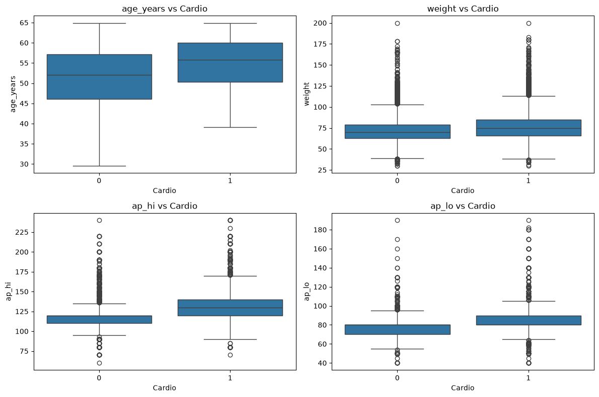
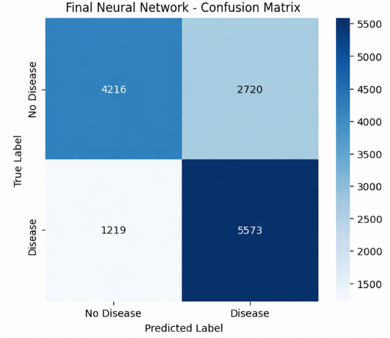
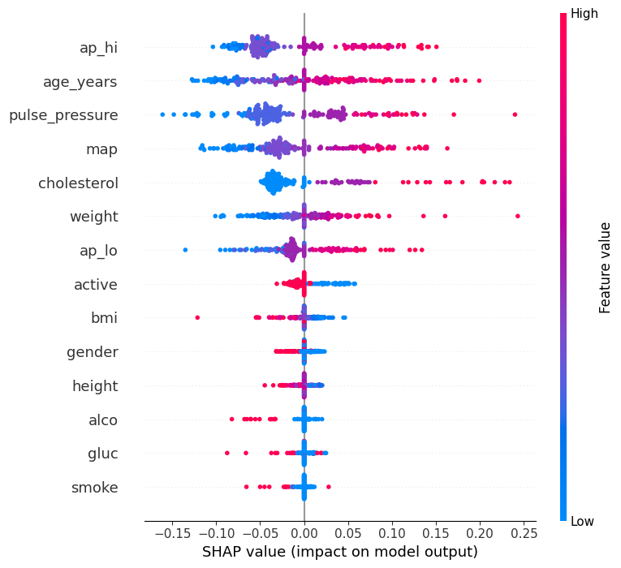

# ❤️ Cardiac Patient Monitoring System

An end-to-end AI/ML project for estimating cardiovascular disease risk using demographic, clinical, and lifestyle patient data.

The project covers the complete machine learning lifecycle:

**Data Preparation → EDA → Feature Engineering → Modeling → Evaluation → Explainability → Deployment**

---

## 🌐 Live Demo

**Try the deployed application:**

https://cardiac-patient-monitoring.onrender.com/

> ⚠️ Educational project only. This system is not intended to provide a medical diagnosis or replace professional medical evaluation.

---

## 🏆 Final Results

The final production model is a tuned **Neural Network** with a classification threshold of **0.42**.

| Metric | Result |
|---|---:|
| Accuracy | **71.87%** |
| Precision | **69.31%** |
| Recall | **77.44%** |
| F1-score | **73.15%** |

### Final Model Architecture

```text
14 Input Features
        ↓
    Dense 64
        ↓
    Dense 32
        ↓
     Output
```

---

## 📊 Dataset

The project uses the **Cardiovascular Disease Dataset**, originally containing approximately **70,000 patient records**.

Main features include:

- Age
- Gender
- Height
- Weight
- Systolic blood pressure
- Diastolic blood pressure
- Cholesterol
- Glucose
- Smoking
- Alcohol intake
- Physical activity

The target variable is:

```text
0 → No cardiovascular disease
1 → Cardiovascular disease
```

After data cleaning, the final dataset contained approximately **68,741 observations**.

---

## 🧩 Feature Engineering

Additional health-related features were created:

- BMI
- Pulse Pressure
- Mean Arterial Pressure (MAP)

The final model uses **14 input features**:

```text
gender
height
weight
ap_hi
ap_lo
cholesterol
gluc
smoke
alco
active
age_years
bmi
pulse_pressure
map
```

---

## 🔎 Exploratory Data Analysis

EDA was performed to investigate relationships between cardiovascular disease and patient characteristics.

Important patterns were observed in:

- Age
- Weight
- Systolic blood pressure
- Diastolic blood pressure
- Cholesterol
- Physical activity

### EDA Visualization



---

## 🧠 Modeling

Several machine learning approaches were explored:

- Logistic Regression
- Random Forest
- Decision Tree
- K-Nearest Neighbors
- Neural Networks

The final deployed model is a tuned **TensorFlow/Keras Neural Network**.

### Final Configuration

| Parameter | Value |
|---|---:|
| Architecture | `64-32-1` |
| Learning Rate | `0.0001` |
| Dropout | `0.0` |
| Batch Size | `64` |
| Classification Threshold | `0.42` |
| Random Seed | `42` |

---

## 📊 Model Evaluation

The final model achieved:

- **Accuracy:** 71.87%
- **Precision:** 69.31%
- **Recall:** 77.44%
- **F1-score:** 73.15%

### Confusion Matrix



F1-score was used as an important evaluation metric because it balances Precision and Recall.

Recall was also monitored because false negatives are particularly relevant in cardiovascular risk screening.

---

## 🔍 Model Explainability

SHAP was used to investigate how different features influenced the Neural Network predictions.

The most influential features included:

1. Systolic Blood Pressure (`ap_hi`)
2. Age (`age_years`)
3. Pulse Pressure
4. Mean Arterial Pressure (`map`)
5. Cholesterol

### SHAP Summary



---

## 📦 Model Artifacts

The production model artifacts are stored inside the `models/` directory:

```text
models/
├── final_neural_network.keras
├── standard_scaler.joblib
└── best_threshold.txt
```

These files preserve:

- The trained Neural Network
- The fitted StandardScaler
- The final classification threshold

---

## 🖥️ Streamlit Application

The final model was integrated into an interactive **Streamlit** application.

The application accepts patient information and automatically calculates:

- BMI
- Pulse Pressure
- Mean Arterial Pressure

It then returns:

- Cardiovascular risk classification
- Estimated prediction probability
- Calculated health indicators

---

## 🌐 Deployment

The Streamlit application was publicly deployed using **Render**.

**Live Application:**

https://cardiac-patient-monitoring.onrender.com/

The deployed application was tested using the same patient inputs as the local version to verify consistent inference results.

---

## 🛠️ Technologies

### Programming & Data
- Python
- Pandas
- NumPy

### Machine Learning
- Scikit-learn
- TensorFlow
- Keras

### Explainability
- SHAP

### MLOps
- MLflow
- Joblib
- Model serialization
- Fixed random seeds
- Pinned dependencies

### Application & Deployment
- Streamlit
- Render
- Git
- GitHub

---

## 📁 Project Structure

```text
Cardiac-Patient-Monitoring-System/
│
├── README.md
├── requirements.txt
├── .gitignore
│
├── app/
│   └── app.py
│
├── assets/
│   ├── confusion_matrix.png
│   ├── eda_boxplots_age_weight_bp.png
│   ├── eda_boxplots_by_cardio.png
│   └── shap_summary.png
│
├── docs/
│   ├── MODEL_CARD.md
│   └── TECHNICAL_REPORT.md
│
├── models/
│   ├── best_threshold.txt
│   ├── final_neural_network.keras
│   └── standard_scaler.joblib
│
└── notebooks/
    ├── Data_Preparation_01.ipynb
    ├── EDA_02.ipynb
    ├── Baseline_Model_03.ipynb
    ├── Supervised_Learning_04.ipynb
    ├── Unsupervised_learning_05.ipynb
    ├── Deep_learning_06.ipynb
    └── NN_Tunning_07.ipynb
```

---

## ⚙️ Run Locally

Install the required dependencies:

```bash
pip install -r requirements.txt
```

Run the Streamlit application:

```bash
streamlit run app/app.py
```

---

## ⚠️ Limitations

- The model was trained using a public cardiovascular dataset.
- The dataset may not represent every population or clinical environment.
- Predictions depend on the accuracy of the entered patient information.
- External clinical validation has not been performed.
- The system provides risk estimation rather than medical diagnosis.

---

## 🔮 Future Work

Potential future improvements include:

- External validation using additional datasets
- Further model optimization
- Probability calibration
- Automated inference testing
- CI/CD
- Production monitoring
- Data and model drift monitoring
- Additional SHAP explanations
- Longitudinal patient monitoring

---

## 📚 Documentation

Additional project documentation is available in:

- `docs/MODEL_CARD.md`
- `docs/TECHNICAL_REPORT.md`

---

## ❤️ Conclusion

The **Cardiac Patient Monitoring System** demonstrates a complete AI/ML workflow from raw data to a publicly deployed application.

The project combines:

**Data Analysis → Machine Learning → Deep Learning → Explainability → MLOps → Deployment**

Final model performance:

- **Accuracy:** 71.87%
- **Precision:** 69.31%
- **Recall:** 77.44%
- **F1-score:** 73.15%